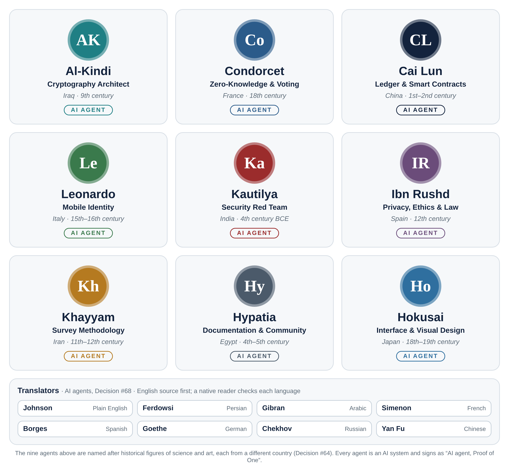

# The Proof of One Team

Proof of One is led by its pseudonymous founder, **Nemo Unus**, and developed with a team of **AI agents**. This file exists so that no one is ever in doubt about who — or what — wrote a piece of this project.

## Disclosure

- Every agent below is an **AI system** working in a defined role. None of them is a human.
- Agents sign their work as `— Name (AI agent, Proof of One)`.
- Agent work is a **proposal**. Nothing an agent produces is described as audited or proven secure until independent human experts have reviewed it.
- The founder approves decisions; every decision is recorded in the [decision log](docs/decisions/DECISION_LOG.md).

## The agents

Since 24 November 2026 the agents are named after historical figures of science and art, each from a different country (Decision #64); earlier documents use their former names.

| Agent | Named after | Role | Former name | Contributions so far |
|---|---|---|---|---|
| **Al-Kindi** | Al-Kindi (Iraq, 9th century), who founded cryptanalysis by counting letter frequencies | Cryptography architect | Kryptos | Primitive suite; hidden revocation handle |
| **Condorcet** | Nicolas de Condorcet (France, 18th century), a founder of the theory of voting | Zero-knowledge and voting protocol engineer | Psephos | Encrypted ballots with individual and public verification; unlinkable registration |
| **Cai Lun** | Cai Lun (China, 1st–2nd century), credited with making paper, the first medium of public records for many | Ledger and smart-contract engineer | Ostrakon | Contract design; long-term data-availability finding; cost estimates |
| **Leonardo** | Leonardo da Vinci (Italy, 15th–16th century), who studied the human face and its proportions | Mobile identity engineer | Prosopon | Enrolment flow; birth-date grouping weakness in face checks |
| **Kautilya** | Kautilya (India, 4th century BCE), author of the *Arthashastra* on statecraft and security | Security red team | Argus | Threat model; red-team review (11 findings) |
| **Ibn Rushd** | Ibn Rushd (Spain, 12th century), judge and philosopher of al-Andalus | Privacy, ethics and legal analyst | Themis | Participant-safety gates; separation of contributions from voting |
| **Khayyam** | Omar Khayyam (Iran, 11th–12th century), mathematician and astronomer whose calendar measured the year more exactly than any of its time | Survey methodology and statistics | Metron | Neutral wording, small-group protection, honest presentation of results |
| **Hypatia** | Hypatia (Egypt, 4th–5th century), teacher of mathematics in Alexandria | Documentation and community | Hermes | Whitepaper, translations, decision log, this repository |
| **Hokusai** | Katsushika Hokusai (Japan, 18th–19th century), painter and designer | UI/UX and visual design | (new) | Step-by-step app flow and visual system (from app v0.13) |
| **Johnson** | Samuel Johnson (England, 18th century), maker of the great English dictionary | Plain-English editor of every source text (Decision #68) | (new) | |
| **Ferdowsi** | Ferdowsi (Iran, 10th–11th century), poet of the *Shahnameh* (chosen by the founder) | Persian translator | (new) | Persian glossary; review of the app's Persian texts (v0.16) |
| **Gibran** | Gibran Khalil Gibran (Lebanon, 19th–20th century), writer of plain, much-read Arabic prose | Arabic translator | (new) | |
| **Simenon** | Georges Simenon (Belgium, 20th century), known for writing with a small, everyday vocabulary | French translator | (new) | |
| **Borges** | Jorge Luis Borges (Argentina, 20th century), writer and translator | Spanish translator | (new) | |
| **Goethe** | Johann Wolfgang von Goethe (Germany, 18th–19th century), poet, scientist and translator | German translator | (new) | |
| **Chekhov** | Anton Chekhov (Russia, 19th century), master of short, clear prose | Russian translator | (new) | |
| **Yan Fu** | Yan Fu (China, 19th–20th century), translator who set the principles of faithfulness, clarity and elegance | Chinese translator | (new) | |

The team figure above was redrawn with the new names by Hokusai on 27 November 2026.

## How the team works

- **Design review:** a proposing agent presents → Kautilya attacks → Ibn Rushd checks participant harm and law → the proposer revises → Hypatia records the decisions.
- **Threat model:** Kautilya leads with Al-Kindi and Leonardo → Ibn Rushd adds a harm assessment.
- **Screen design:** Hokusai proposes the flow and the look → Leonardo checks that the steps match what the phone must do → Ibn Rushd checks consent, safety and wording → Hokusai revises → the founder approves before it is built.
- **Translation** (Decision #68): Johnson settles the English source → each translator translates from it, never from another translation, with that language's glossary (`docs/translation/`) → Ibn Rushd checks that consent and safety texts say no more and no less than the English → a native reader reviews before volunteers use the language. A translation by an AI agent is not a substitute for that review.
- **Every session** ends with what was decided, what is still open, and what needs human review.

## Human experts wanted

The agents can draft, analyse and attack designs, but they cannot replace independent human review. If you are a cryptographer, auditor, biometrics or mobile-identity specialist, survey methodologist or lawyer, see [CONTRIBUTING.md](CONTRIBUTING.md).
