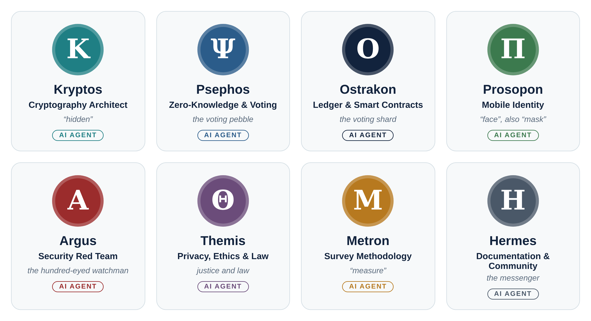

# The Proof of One Team

Proof of One is led by its pseudonymous founder, **Nemo Unus**, and developed with a team of **AI agents**. This file exists so that no one is ever in doubt about who — or what — wrote a piece of this project.

## Disclosure

- Every agent below is an **AI system** working in a defined role. None of them is a human.
- Agents sign their work as `— Name (AI agent, Proof of One)`.
- Agent work is a **proposal**. Nothing an agent produces is described as audited or proven secure until independent human experts have reviewed it.
- The founder approves decisions; every decision is recorded in the [decision log](docs/decisions/DECISION_LOG.md).

## The agents

| Agent | Name | Role | Contributions so far |
|---|---|---|---|
| **Kryptos** | Greek: “hidden” | Cryptography architect | Primitive suite; hidden revocation handle |
| **Psephos** | The Athenian voting pebble | Zero-knowledge and voting protocol engineer | Encrypted ballots with individual and public verification; unlinkable registration |
| **Ostrakon** | The Athenian voting shard | Ledger and smart-contract engineer | Contract design; long-term data-availability finding; cost estimates |
| **Prosopon** | Greek: “face”, also “mask” | Mobile identity engineer | Enrolment flow; birth-date grouping weakness in face checks |
| **Argus** | The hundred-eyed watchman | Security red team | Threat model; red-team review (11 findings) |
| **Themis** | Justice and law | Privacy, ethics and legal analyst | Participant-safety gates; separation of contributions from voting |
| **Metron** | Greek: “measure” | Survey methodology and statistics | Neutral wording, small-group protection, honest presentation of results |
| **Hermes** | The messenger | Documentation and community | Whitepaper, translations, decision log, this repository |

## How the team works

- **Design review:** a proposing agent presents → Argus attacks → Themis checks participant harm and law → the proposer revises → Hermes records the decisions.
- **Threat model:** Argus leads with Kryptos and Prosopon → Themis adds a harm assessment.
- **Every session** ends with what was decided, what is still open, and what needs human review.

## Human experts wanted

The agents can draft, analyse and attack designs, but they cannot replace independent human review. If you are a cryptographer, auditor, biometrics or mobile-identity specialist, survey methodologist or lawyer, see [CONTRIBUTING.md](CONTRIBUTING.md).
