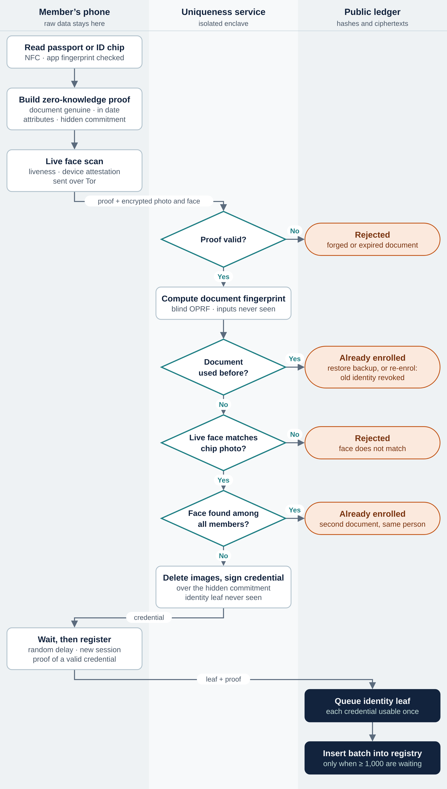
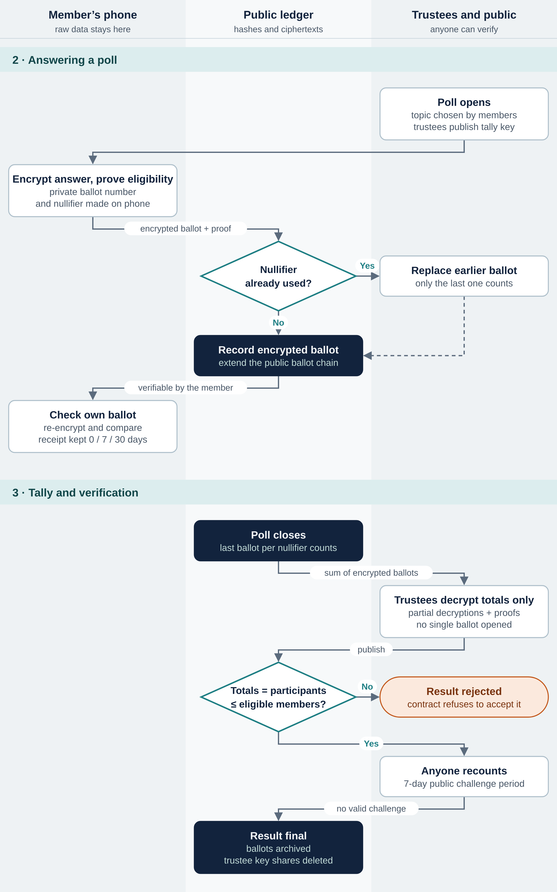

# Proof of One — An Open, Verifiable Polling Network Built on One-Person-One-Identity

*Whitepaper — Version 0.5 (Public Review Draft) · October 2026 · Nemo Unus, with the Proof of One AI agent team*

> Open-source, non-commercial project. Draft for public review. Not audited: all designs require independent human review before use with real participants.

## 1. Executive Summary

Public opinion is now measured online, but online opinion can no longer be trusted. Bots and AI agents can produce thousands of convincing “respondents” for almost nothing, one person can answer many times, the age or nationality a respondent claims cannot be checked, and nobody outside the organiser can verify that a published result is the true count of what people answered.

**Proof of One** is an **open-source, non-commercial protocol** that lets anyone in the world take part in polls in which every participant is a real, unique human who can register only once, and no one — including the people who run the system — can see who answered what. A member enrols once with an ordinary smartphone, by reading the electronic chip of their passport or national ID card and matching their live face to the photo stored on that chip. The network learns only that this is a genuine, unique person with certain verified attributes, such as an age band and a nationality.

Two properties are fixed and non-negotiable:

- **Every participant can verify their own vote.** Each participant can check, from their own phone, exactly what was recorded on the public ledger for their vote and that it was included in the count.
- **Anyone can recount the result.** Every ballot is published in encrypted form; anyone can add them up and check the published totals and the mathematical proofs that they were decrypted correctly, without trusting any operator.

Around these, the design adds strong protection for participants: ballots are encrypted so that even a seized phone or a stolen key does not reveal past answers once a short verification window has passed; the service that checks uniqueness cannot link a person to their anonymous identity; and participation is **free** for everyone. The topics of sponsored polls are **chosen by participants themselves**, region by region, with a global track for questions that concern everyone.

The project is led by a pseudonymous founder, **Nemo Unus**, and developed openly with a team of **disclosed AI agents** whose work is published for review by independent human experts. All code and specifications are open source. Nothing will be used with real participants until it has passed a public test network, a bug bounty and an independent human audit.

> Design commitment: one human, one voice — owned by the person, verifiable by anyone, controlled by no single government, company or operator.

## 2. The Problem

### 2.1 Online opinion cannot be trusted

- **Fake participants.** Generative AI makes it cheap to create accounts, faces and convincing written answers at scale. Online polls, petitions and review systems cannot tell people from machines.
- **Duplicate participants.** One person with several e-mail addresses or phone numbers can answer many times.
- **Unverifiable demographics.** Respondents state their own age, nationality and location; nobody can check them, so breakdowns by group are only as honest as the respondents.
- **Unverifiable results.** Results are published by the organiser. Participants cannot confirm that their answer was counted, and the public cannot recount.

### 2.2 The verification gap in collective decisions

The same gap exists in formal decision-making. Registering participants, collecting votes and counting them are usually operated and verified by a single authority. Participants are asked to trust the announced result. Where the counting authority is not independent, manipulation is possible and hard to prove; and because each consultation is expensive, people are consulted rarely.

### 2.3 Why existing digital identity does not solve it

Proof-of-personhood projects (Section 5) show strong demand but leave gaps: some depend on proprietary scanning hardware; some accept a single identity document, so a person with two passports can register twice; national digital wallets stop at a country’s borders; and none treats verifiable public opinion as its primary purpose.

## 3. Vision: the Missing Human Layer

The internet has infrastructure for addressing computers, moving data and making payments, but none for humans. It cannot tell whether an account belongs to a person or a program, or whether a hundred accounts belong to one person. In an era when AI can produce convincing synthetic people at almost no cost, this gap becomes critical. Proof of One aims to provide that missing layer, starting with the use case that needs it most.

| Pillar | What it enables | Status |
|---|---|---|
| 1. Verifiable collective decisions | Polls, consultations, petitions and — where legally authorised — binding votes, with results anyone can check | **First product: verifiable polling** |
| 2. Fair distribution | Anything allocated “one per person”: aid, quotas, ticketing, rewards, and potentially a share of value created by AI | Later phase |
| 3. Human authenticity | Proof that a voice, review, piece of content or decision comes from a real, unique human | Later phase |

## 4. Design Principles

| Principle | What it means in practice |
|---|---|
| One human, one identity | A person can hold only one active identity. Both the identity document and the face are checked for duplicates at enrolment. |
| Verifiable by the voter and by everyone | Each participant can check their own recorded vote; anyone can recount every total from public data. |
| Participant safety first | Where safety, integrity and convenience conflict, the safety of participants wins. The design assumes an adversary with the resources of a state. |
| Private, not anonymous | Every member is a verified, unique real person, but no one can link an answer — or an anonymous identity — to a person. |
| Data minimisation | Passport data and face images are processed on the phone and in an isolated enclave; nothing personal is written to the ledger. |
| Free and neutral | Participation costs nothing. The project does not choose poll topics; participants do. |
| Open source, non-commercial | All code and specifications are public. There is no business model, token or investor. |
| Ordinary hardware | A mainstream smartphone with a camera and NFC is enough. No proprietary scanner is required. |
| Progressive decentralisation | Trust is spread across independent operators and trustees in different jurisdictions as the network grows. |
| Honesty about limits | Known weaknesses are documented (Sections 12 and 17), including what the system cannot do against a state that issues identity documents. |

## 5. Landscape and Differentiation

| Initiative | Approach | Uniqueness check | Polling focus |
|---|---|---|---|
| World ID | Iris scan by a proprietary Orb; anonymous proof of human. Over 18 million Orb-verified users reported in 2026 [1] | Iris (biometric) | Not primary |
| Humanity Protocol | Palm scan and zero-knowledge proofs; mainnet since August 2025 [2] | Palm (biometric) | No |
| Human Passport | Aggregates many independent checks into a humanity score [3] | Score, not guaranteed | Indirect |
| Self, ZKPassport | Read the passport chip by NFC and prove attributes with zero-knowledge proofs [4][5] | Document only | No |
| National wallets (EU, Bhutan) | Government-issued digital identity [7][8] | Government registry | No |
| Online survey panels | Respondents recruited and checked by the panel operator | Operator’s own checks | Yes, but results not publicly verifiable |
| Vocdoni, MACI | Blockchain and zero-knowledge voting protocols [13] | Voter list supplied by organiser | Yes |
| **Proof of One** | **Passport chip + live face on a phone; verifiable polls with verified demographics** | **Document and face** | **Core product** |

### 5.1 What is different

- **Two-layer uniqueness.** Document-only systems let a person with two passports register twice; biometric-only systems on a phone are open to synthetic faces. Requiring a government-signed document **and** a face that matches it, and checking both for duplicates, closes both gaps.
- **Verified demographics without identification.** Results can be reported by verified age band and nationality, which ordinary online polls cannot offer, while answers remain unlinkable to individuals.
- **Public verifiability as the purpose,** not an add-on: every answer can be checked by its author, and every total by anyone.
- **No proprietary hardware.** The phone’s NFC reader and camera replace a network of scanning stations.

## 6. System Architecture

### 6.1 Separation of functions

An identity system has to answer three different questions. Proof of One answers each with a different mechanism:

| Function | Question | Mechanism |
|---|---|---|
| Uniqueness | Has this person registered before? | Document fingerprint and face template, checked once at enrolment inside an isolated enclave (6.6, 6.7) |
| Ownership | Is this request coming from the holder of this identity? | Identity secret held on the phone, protected by secure hardware and the user’s PIN (6.8) |
| Recovery | The phone is lost or the passport renewed — how is access restored? | Restoring the encrypted backup, or re-enrolment after a cooling-off period with automatic revocation of the old identity (6.10) |

Neither the passport number nor biometric data is used to build the user’s key. Passports are renewed with new numbers, and two scans of a face are never identical, so either would make the key unstable. Biometric features are also not secret: a face appears in photographs. Biometrics are therefore used only to establish uniqueness, never as a key.

### 6.2 Process overview

Figures 1 and 2 show the complete process across the four parties: the member’s phone, the uniqueness service, the public ledger, and the poll organiser and public.



*Figure 1 — Enrolment. Four checks run in the uniqueness service; each failure stops enrolment. The service signs a credential over a hidden commitment, and the phone registers its identity later, unlinkably (6.3, 7.10).*



*Figure 2 — Answering a poll, tally and verification. Ballots are encrypted on the phone; only totals are decrypted, with public proofs; the contract rejects any result whose totals do not match the participants (7.7, 8.7).*

### 6.3 Enrolment steps

1. The user installs the app — after checking its signing fingerprint against the published one — and creates a PIN. The phone generates its keys (6.8).
2. The user holds their passport or chip-based national ID card against the phone. The app reads the chip by NFC.
3. The phone builds a zero-knowledge proof that the document is genuine and in date, that the claimed attributes are correct, and that a commitment to the chip photo matches the signed document (7.4).
4. The user performs a live face scan; the phone adds a hardware attestation that the genuine app is running on an uncompromised device.
5. Over an anonymising network connection, the phone sends the proof, a commitment that hides its future identity, and — encrypted so that only the attested enclave can open it — the chip photo and the live face frames (7.6).
6. The uniqueness service verifies the proof, checks the document fingerprint (Layer 1), and inside the enclave matches the live face to the chip photo and checks the face for duplicates (Layer 2).
7. If every check passes, the enclave deletes the images and returns a signed **credential** over the hidden commitment.
8. Hours later, in a separate session, the phone registers its identity on the ledger with a zero-knowledge proof that it holds a valid credential, without revealing which one (7.10). Identities are added to the ledger only in large batches (8.3).

### 6.4 Reading the identity document

Most passports issued today, and many national ID cards, contain a contactless chip defined by the ICAO 9303 standard [6]. Data group DG1 holds the data printed on the photo page (name, document number, nationality, date of birth, sex, expiry), DG2 holds the facial image, and the Document Security Object (SOD) holds the hashes of all data groups, signed by a Document Signer Certificate (DSC) that is in turn signed by the issuing state’s Country Signing CA (CSCA). Reading the chip is required instead of uploading a photo of the document, because a photo can be fabricated in seconds while the signature chain cannot. Where the chip supports active or chip authentication, it is used to detect cloned chips.

### 6.5 Face matching in the enclave

Zero-knowledge proofs show that a computation on given inputs was correct; they cannot show that an input came from a real camera. Face matching and template extraction therefore run inside the uniqueness service’s hardware enclave, not on the phone. The enclave checks that the chip photo it receives is the one committed in the proof, runs liveness and face matching against that photo, and builds the face template itself — so a modified app cannot submit someone else’s template. The authenticity of the camera feed rests on the phone’s hardware attestation and presentation-attack detection, which is recorded as a residual risk (Section 12).

### 6.6 Layer 1 — document uniqueness

From stable fields of DG1 the phone derives a **document fingerprint** through an oblivious pseudorandom function (OPRF) whose key is held by the uniqueness service (7.5). Because passport data has relatively few possible combinations, a plain hash could be reversed by trying every possibility; the keyed OPRF prevents this, and its blinding ensures the service computes the fingerprint without seeing the data. Stable fields are used instead of the document number, so a renewed passport produces the same fingerprint.

### 6.7 Layer 2 — face uniqueness

Layer 1 does not stop a person who holds two different documents. Layer 2 compares the new face template with existing templates. Version 0.4 limited this search to members with the same date of birth and sex. Red-team review showed that this is unsafe against an issuer of documents, which can print a different birth date in each document for the same person. Version 0.5 therefore removes date of birth from the search: duplicates are searched **across all members** (or within sex only), using an approximate-nearest-neighbour index and a strict threshold for candidates.

Searching a large population increases the chance that two different people look alike. The final method and threshold will be chosen only after the accuracy study measures false-match and false-reject rates at one million, ten million and one hundred million members. A one-way hash of the face cannot replace this comparison: a hash destroys similarity, so two scans of the same face would produce unrelated values, and a coarsened template would be guessable from a public photograph.

| Stage | Protected comparison | Trust assumption |
|---|---|---|
| Test network and low-risk pilot (Phases 0–2) | Encrypted templates compared inside a hardware-isolated enclave (for example AWS Nitro Enclaves) | Enclave hardware and cloud provider; reproducible, independently audited enclave code |
| Before any use in high-risk settings (Phase 3) | Templates split into secret shares across independent operators in different jurisdictions and compared by multi-party computation (MPC) | No single operator, company or government; a threshold of operators would have to collude |

### 6.8 The member’s keys

The phone holds two keys with different jobs (7.3): a **device key** generated inside the secure hardware, used to protect local data and bind the app to the device; and an **identity secret**, used only inside zero-knowledge proofs, stored encrypted under the device key and backed up end-to-end encrypted by the user. From the identity secret the phone derives a readable **member number** for the user’s own reference, for example:

> ONE-7Q4KM-9M2XH-8T3VA-5RZ0P-K

The member number is never published or sent anywhere. The ledger stores only an identity leaf — a hash that reveals nothing about the person — and never names, document numbers or biometric data.

### 6.9 Verified attributes and selective disclosure

Attributes read from the chip stay on the phone as bands (for example, age band 40–49) and are sealed in an attribute commitment inside the member’s ledger entry (8.3). When a poll needs them, the phone proves in zero knowledge exactly what is required, such as “aged 18 or over” or “national of country X”, without revealing the underlying values.

### 6.10 Recovery

- **Lost or replaced phone, backup available:** the user restores the encrypted backup of the identity secret on a new phone. The identity is unchanged and nothing is written to the ledger.
- **No backup available:** the user re-enrols with their document and a live face match. The enclave recognises the person, waits a cooling-off period (for example 14 days), then publishes the old identity’s hidden **revocation handle** and issues a new credential. The old identity can no longer take part in any poll; the enclave still cannot tell which ledger entry was revoked (7.11).
- **Renewed passport:** the stable document fields produce the same document fingerprint, so the person remains recognised as already enrolled.
- **Open polls:** each poll fixes its membership and revocation snapshots when it opens, so a recovered identity cannot answer an open poll twice (8.4).

### 6.11 What each party sees

| Data | Member’s phone | Uniqueness service | Public ledger |
|---|---|---|---|
| Passport data (DG1) | Yes | Attributes only; fingerprint input blinded | No |
| Chip photo and live face images | During the scan | Inside the enclave only; deleted after checks | No |
| Face template | No | Encrypted; compared only in the enclave (later MPC) | No |
| Document fingerprint | Yes | Yes | No |
| Identity leaf | Yes | **No** — sees only a hiding commitment | Yes (reveals nothing) |
| Age band, nationality | Yes | Yes, at enrolment | Hidden inside the leaf |
| Content of an answer | Own answer, during the receipt window | No | Encrypted; only totals decrypted |
| Whether a member took part | Own participation | No | Not linkable without the member’s secret |

## 7. Cryptographic Specification

This section proposes concrete algorithms for each function. The choices favour open standards, audited open-source implementations and compatibility with existing passport and zero-knowledge tooling. They are proposals for Phase 0 and will be confirmed by independent cryptographic review.

### 7.1 Design goals

- **Standards first:** use published standards (ICAO 9303, RFC 9497, RFC 9180) and widely reviewed constructions rather than new cryptography.
- **Proof-friendly where proofs are needed:** use arithmetic-friendly primitives (Poseidon, Baby Jubjub) inside zero-knowledge circuits, and conventional primitives (SHA-256, P-256, AES-GCM) elsewhere.
- **Hardware-backed keys:** every long-lived secret is generated in, or encrypted by, the phone’s secure hardware.
- **Cryptographic agility:** every record carries an algorithm version so that primitives can be replaced, including by post-quantum alternatives.

### 7.2 Proposed primitive suite

| Purpose | Proposed primitive | Reason |
|---|---|---|
| Hash inside circuits | Poseidon over the BN254 scalar field [23] | Far fewer constraints than SHA-256 inside zero-knowledge proofs |
| Hash outside circuits | SHA-256 | Matches passport SOD hashing; universal support |
| Device key | ECDSA P-256 in Secure Enclave / StrongBox | Natively supported by phone secure hardware and attestation |
| Identity secret | EdDSA key on the Baby Jubjub curve [29] | Efficient to use inside BN254 circuits; same model as Semaphore [12] |
| Poll membership proofs | Groth16 on BN254 [24] | Smallest proofs and cheapest on-chain verification; reuses Semaphore’s audited circuits and setup |
| Document proofs | Universal-setup system such as PLONK / UltraHonk [25] | One circuit per signature algorithm; no per-circuit trusted setup; reuses open passport circuits [4][5] |
| Document fingerprint | 2HashDH OPRF with verifiable mode, structure of RFC 9497 [21] | Keyed and blinded: the service never sees the input; outputs cannot be brute-forced |
| Channel to the enclave | HPKE (RFC 9180): X25519, HKDF-SHA256, AES-256-GCM [22] | Standard public-key encryption, key bound to the enclave’s attestation document [28] |
| Template storage | AES-256-GCM, key released only to attested enclave code | Templates are unreadable outside the enclave |
| Enrolment credential | EdDSA on Baby Jubjub, verified inside a zero-knowledge proof | Lets a member prove they hold a credential without revealing which one |
| Ballot encryption and tally | Exponential ElGamal on Baby Jubjub; threshold key from a distributed key generation; Chaum–Pedersen (DLEQ) decryption proofs [30][33] | Additively homomorphic: anyone can add encrypted ballots; trustees decrypt only totals and prove they did so correctly |
| Revocation set | Indexed (sorted) Merkle tree with non-membership proofs | Proves a hidden handle is not revoked without revealing it |

### 7.3 Keys and identity commitment

At enrolment the phone creates the following values. Only commitments and hashes ever leave the phone.

```
K_dev   = P-256 key pair in secure hardware (non-exportable)
s       = random Baby Jubjub scalar (identity secret)
          stored as Enc_K_dev(s); backup end-to-end encrypted
P       = s · G                         (Baby Jubjub public key)
idc     = Poseidon(Px, Py)              (identity commitment)
attr    = Poseidon(ageBand, natCode, sexCode, expiryMonth, salt_a)
rn      = revocation handle issued by the enclave (7.11)
leaf    = Poseidon(idc, attr, rn)       (entry in the registry tree)
cm      = Poseidon(idc, salt_a, ρ)      (hiding commitment for enrolment)
cn      = Poseidon(ρ)                   (credential nullifier)
```

### 7.4 The enrolment proof

The phone proves the following statement in zero knowledge. Private inputs never leave the phone; public inputs are seen by the uniqueness service.

|  | Values |
|---|---|
| Private inputs | DG1, DG2 hash, SOD, Document Signer Certificate, CSCA public key and its Merkle path, salts r_f and salt_a, ρ, idc |
| Public inputs | Root of the trusted CSCA key list; today’s date; claimed attribute bands; C_face; blinded fingerprint input B; the hiding commitment cm; a fresh challenge from the service |

1. **Integrity:** SHA-256(DG1) and the DG2 hash equal the values listed in the SOD.
2. **Authenticity:** the SOD signature verifies under the DSC; the DSC signature verifies under a CSCA key; that key is a leaf of the trusted CSCA list.
3. **Validity:** the expiry date in DG1 is later than today.
4. **Attributes:** the age band and nationality code are correctly derived from DG1.
5. **Photo binding:** C_face = Poseidon(DG2-hash, r_f), tying the photo sent to the enclave to the signed document.
6. **Fingerprint input:** B is the blinding of the stable DG1 fields described in 7.5.
7. **Binding:** the proof includes cm and the service’s challenge, so it cannot be replayed. The service never learns idc or the future identity leaf.

### 7.5 Document fingerprint protocol

```
Phone:   x = HashToCurve(nationality || dateOfBirth || name || sex)
         r = random scalar;  B = r · x       (blinded; sent with proof)
Service: Z = k · B, with proof that key k was used  (k = service secret)
Phone:   F = Hash(x, r⁻¹ · Z)                 (document fingerprint)
Ledger:  stores F; any repeated F is rejected
```

For the circuit in 7.4 to prove that B is derived from the signed fields, the OPRF is instantiated over the circuit-friendly Baby Jubjub group, following the 2HashDH structure of RFC 9497. In Phase 3 the key k is split across operators (threshold OPRF), so no single party can compute fingerprints alone.

### 7.6 Enclave channel and face template

- The enclave publishes an attestation document containing the hash of its code and its HPKE public key. The phone verifies the attestation against the published, reproducible build before encrypting anything to it.
- The phone sends HPKE-encrypted: the DG2 photo, r_f, and a short sequence of live face frames.
- Inside the enclave: check Poseidon(SHA-256-based DG2 hash, r_f) = C_face; run liveness and face matching; compute a face embedding (for example a 512-value vector from a published face-recognition model); delete all images.
- Templates are stored encrypted and compared by similarity across all members (6.7); the match threshold is calibrated on real data in the accuracy study.
- Output: a credential σ = Sign(Poseidon(attributes, cm, rn, epoch)) under an enclave key listed on the ledger (7.10).

### 7.7 Answering a poll

Each poll has its own tally public key PK, created by a committee of independent trustees through a distributed key generation; no single trustee holds the private key. A member’s choice is encoded as a vector with a 1 in the chosen option and 0 elsewhere, and each position is encrypted:

```
nf     = Poseidon(pollId, s)          (nullifier: one per member per poll)
ballot = first 48 bits of nf, e.g. 7F3A-91C2-E04B  (private ballot number)
C_j    = (r_j · G,  v_j · G + r_j · PK)    for each option j
proof  : leaf is in the poll’s snapshot tree; rn is not revoked;
         nf is derived from s; attr meets the eligibility rule;
         every v_j is 0 or 1 and they sum to 1;
         each C_j encrypts v_j under PK; bound to this submission
```

The ledger keeps the latest ballot per nullifier. A member who answers again produces the same nullifier, so the new ballot replaces the old one and is never counted twice. Because nf depends on the poll identifier, a member’s nullifiers in different polls cannot be linked. For a poll with four options the proof is estimated at about 40,000 constraints, which current phone provers handle in seconds; this must be measured on low-cost phones.

### 7.8 Verifying one’s own vote and recounting

- **Own vote (recorded as cast).** The phone keeps the choice and the random values r_j for a receipt window chosen by the member for each vote — none, 7 or 30 days after the poll closes. During that window it recomputes the ciphertexts and checks that they match the ledger, using several independent data sources. Afterwards the record is deleted automatically.
- **Counted as recorded.** After publication, the phone checks that its ballot is the last one for its nullifier in the final ballot set, recomputes the totals and checks the decryption proofs.
- **Auditing the app (optional).** Before submitting, a member may choose to audit a ballot: the app reveals its random values so that anyone can check it encrypts the displayed choice; that ballot is discarded and a new one prepared [32].
- **Public recount.** Anyone can take every last ballot per nullifier, add the ciphertexts per option, combine the trustees’ published partial decryptions and verify their proofs. The decrypted totals must equal the number of distinct participants.

### 7.9 Verified breakdowns without exposing small groups

When a poll reports results by a verified attribute (for example age band), the ballot vector is indexed by option and by the member’s cell, and the proof shows that the cell matches the attribute hidden in the member’s identity. Trustees first decrypt only the number of participants per cell; cells below the minimum size (for example 50) are merged by a rule fixed in advance, and only then are option totals decrypted. No individual ballot is ever decrypted.

### 7.10 Unlinkable registration

To keep the uniqueness service from linking a person to their identity on the ledger, the enclave signs only the hiding commitment cm. Later, the phone submits (leaf, cn) with a zero-knowledge proof of the following statement:

```
leaf = Poseidon(idc, Poseidon(attrs, salt_a), rn),  idc derived from s
cm   = Poseidon(idc, salt_a, ρ),   cn = Poseidon(ρ)
σ is a valid enclave signature on Poseidon(attrs, cm, rn, epoch)
      under a key in the published enclave key-set root
```

The enclave knows cm but not ρ or idc, so it cannot recognise leaf or cn; the proof reveals neither cm nor σ. The credential nullifier cn prevents one credential from being used twice. A random delay, an anonymising network, a minimum batch size for insertion and hiding the signing epoch protect against matching by timing.

### 7.11 Revocation without linking

At each enrolment the enclave derives a revocation handle rn from the person’s document fingerprint and an enrolment counter, and includes it in the credential. rn is hidden inside the leaf. When a person re-enrols, the enclave publishes the old rn to a public revocation list. Every ballot proof shows that the member’s hidden rn is not on that list. The enclave knows rn but not the leaf, so publishing it revokes the old identity without revealing which ledger entry it was. Every revocation is logged publicly with a reason code, and revocation counts are public, so unusual activity is visible.

### 7.12 Cryptographic agility and the quantum horizon

Every registry entry, poll and ballot records an algorithm version. The elliptic-curve primitives used here are not resistant to future large quantum computers: encrypted ballots kept on a public ledger could in principle be decrypted by such a computer in the future (“harvest now, decrypt later”). The design limits exposure by keeping personal data off the ledger, deleting trustee key shares after each tally, and planning migration to post-quantum encryption, signatures and proof systems as they mature. This remains an open question (Section 17).

## 8. Ledger Design

### 8.1 Choice of network

| Option | Strengths | Weaknesses | Use |
|---|---|---|---|
| Ethereum mainnet | Highest security and neutrality | High and variable fees per answer | Periodic anchoring of state roots |
| Ethereum Layer-2 rollup | Low fees; inherits Ethereum security; EVM tooling and audited contracts | Sequencer operated by a company; data costs at very large scale | **Proposed for Phases 0–3** |
| Dedicated application chain | Full control of fees and validators | Must build its own validator security and neutrality | Option for later phases |
| Private or permissioned ledger | Simple to operate | Not publicly verifiable — defeats the purpose | Not used |

Contracts use standard EVM interfaces so that they can be deployed on any EVM network. The chosen rollup must offer a working forced-inclusion path to Ethereum, so that no sequencer can permanently censor ballots, and its maturity will be checked against independent assessments such as L2BEAT at selection time [35].

**Long-term availability.** Rollups post their data to Ethereum as blobs that ordinary nodes keep for only about 18 days [26]. Recounting must remain possible for years, so after each poll the full ballot set is archived by several independent archivers on content-addressed storage, and the archive’s hash is recorded on the ledger. Anyone can rebuild the archive from an archive node and compare.

### 8.2 Contracts

| Contract | Holds | Key functions |
|---|---|---|
| IdentityRegistry | Merkle tree of identity leaves (depth 32); used credential nullifiers; queue of pending leaves; historical roots | register, insertBatch |
| RevocationRegistry | Indexed Merkle tree of revoked handles; public revocation counters and reason codes | revokeBatch |
| EnclaveKeyRegistry | Root of valid enclave signing keys; enclave image measurements matching reproducible builds | updateKeySet (time-locked) |
| PollRegistry | Poll parameters: content hash, options, eligibility rule, snapshot roots, eligible count, times, tally key, trustee set, verifier | createPoll, attachTallyKey |
| PollAnswers | Latest ballot per nullifier; re-vote counter; ordered ballot chain; count of distinct participants | vote |
| ResultsRegistry | Totals, decryption transcript hash, archive hash, challenge state | publish, challenge, finalize, markWithheld |

**Past polls cannot be changed.** Each poll fixes, at creation, the verifier it uses and its snapshot roots. No later upgrade can alter how an existing poll is checked or counted.

### 8.3 Registering a member

```
register(leaf, cn, keySetRoot, proof)
  require cn not used; keySetRoot is valid; proof verifies (7.10)
  mark cn used; append leaf to the pending queue
insertBatch(count, newRoot, batchProof)       (anyone may call)
  require count ≥ K (minimum batch, e.g. 1,000)
  require batchProof shows newRoot = old root + next `count` leaves
  update root; record newRoot as a valid historical root
```

Inserting one leaf at a time into a depth-32 tree would cost roughly 650,000 gas; proving the update for a whole batch at once costs about 400,000 gas in total, an approach already used in production [31]. The minimum batch size also guarantees every new member a large anonymity set.

### 8.4 Creating a poll and the membership snapshot

When a poll is created, the current identity root and revocation root are stored as its **snapshots**, together with the number of eligible identities. Only members in the snapshot whose handle is not revoked can answer. Trustees then attach the poll’s tally key with their signatures; ballots are accepted only after that. A poll stays open for at least 48 hours so that forced inclusion remains usable if a sequencer censors. The poll text and options are stored on content-addressed storage with their hash on the ledger, so the wording cannot be changed after publication.

### 8.5 Recording a ballot

```
vote(pollId, nf, C, ctxHash, proof)
  require poll open; C has the expected length
  require proof verifies against the poll’s snapshots and tally key
  require re-votes for nf below the cap (e.g. 10)
  if first ballot for nf: distinctVoters += 1
  latest[pollId][nf] = hash(C);  extend ballotChain[pollId]
  emit Ballot(pollId, nf, C, count)
```

### 8.6 Relay service: no cryptocurrency, no IP address

Members never need a crypto wallet or tokens. The phone sends its ballot through a relay service that pays the transaction fee (an ERC-4337 paymaster or equivalent [27]). Because the proof is bound to the ballot, the relay cannot change it. The app connects through an anonymising network with censorship-circumvention transports [34], so neither relays nor network observers learn the member’s IP address. Several independent relays operate, and a member can always submit directly.

### 8.7 Closing, tallying and publishing

1. At the close time no further ballots are accepted. The last ballot per nullifier counts.
2. Anyone adds the ciphertexts per option. Trustees publish partial decryptions of these totals with proofs of correctness (7.8).
3. The trustees publish the result. The contract checks that the ballot chain matches, that the totals add up exactly to the number of distinct participants, and that this number does not exceed the eligible identities in the snapshot.
4. A public challenge period (for example 7 days) follows. Anyone can submit evidence of an invalid decryption proof or a wrong aggregate. If no valid challenge arrives, the result becomes final.
5. If no result is published within a deadline (for example 14 days after closing), anyone can mark the poll as “result withheld”; the number of participants and the ballot chain remain public facts.
6. After the challenge period, trustees delete their key shares and publish signed statements, so that no later compromise can decrypt individual ballots.

### 8.8 On-chain and off-chain data

| Data | Where | Visible to |
|---|---|---|
| Identity leaf, credential nullifier, revoked handles | Ledger | Everyone (reveal nothing about persons) |
| Poll definition hash, snapshot roots, tally key, times | Ledger | Everyone |
| Encrypted ballots, nullifiers, ballot chain | Ledger and long-term archives | Everyone (content encrypted) |
| Totals, decryption transcript, archive hash | Ledger and archives | Everyone |
| Poll text and options | Content-addressed storage | Everyone |
| Document fingerprints and face templates | Encrypted store, readable only in the enclave (later MPC) | No one outside the enclave |
| Passport data, identity secret, receipt | Member’s phone only | The member |

### 8.9 Scale and cost

| Operation | Estimated Layer-2 gas |
|---|---|
| Register an identity (proof check and storage) | about 300,000 |
| Insert a batch of 1,000 identities | about 400,000 in total |
| Cast a ballot, four options | about 420,000 |
| Publish a result | about 300,000 |

At assumed Layer-2 prices, a single ballot costs roughly one to fifteen US cents, so a poll with one million participants could cost roughly ten to one hundred and fifty thousand dollars. Because participation is free and paid from a common fund (Section 10), cost reduction is a priority: **ballot aggregation** — one recursive proof covering many ballots — is planned for Phase 1 and is expected to cut costs by ten to one hundred times. Aggregators cannot censor, because members can always submit directly. All figures are estimates to be measured on a test network.

### 8.10 Contract governance

A time-locked multi-signature group of independent, pseudonymous signers can deploy new verifier versions, update the enclave key set and change default parameters for future polls. It cannot alter any existing poll, ballot, result or root, cannot pause an open poll and cannot revoke identities. The aim is to give up upgrade power over the core registries once the system is stable.

## 9. Core Product: Verifiable Polling

### 9.1 Poll lifecycle

1. **Propose and select.** Sponsored polls are proposed and selected by participants (Section 10). Self-funded polls can be created by anyone who pays their own costs.
2. **Participate.** An eligible member answers in the app. The phone proves eligibility in zero knowledge and submits an encrypted ballot under a private ballot number.
3. **Review and change.** Until the poll closes, the member can check their recorded ballot and change their answer; only the last answer counts.
4. **Close, publish and verify.** Totals are decrypted with public proofs, published with verified breakdowns and opened for a public challenge period. Anyone can recount.

### 9.2 The private ballot number

For each poll, the participant’s phone — not the network — generates a private ballot number and a poll-specific **nullifier** derived from the member’s secret. The nullifier prevents the same person from being counted twice in that poll but cannot be linked to the person or to their ballots in other polls. The encrypted ballot is recorded on the public ledger under the ballot number, with a zero-knowledge proof that it comes from an eligible, unique member [12]. Because no one else ever holds the link between members and ballot numbers, no operator can tell who answered what, even if compelled to.

### 9.3 Protecting participants

- **Receipt window.** The member chooses for each vote how long their phone keeps the information needed to verify it: none, 7 or 30 days after the close. After that, nothing on the phone reveals the answer.
- **Duress PIN.** A second PIN opens the app in a state with no records.
- **No history.** The app keeps no list of polls answered beyond the active receipt windows.
- **Anonymous network access.** All connections go through an anonymising network; enrolment and voting never happen in the same session.
- **Verifying the app.** Builds are reproducible and the signing-key fingerprint is published in several independent places, so members can detect counterfeit apps.

### 9.4 Assurance modes

| Mode | Typical use | Ballot | Protection |
|---|---|---|---|
| Standard (default) | All public-opinion polls | Encrypted; only totals decrypted | Re-answer until close; receipt window; trustee share deletion |
| Open (opt-in) | Non-sensitive questions where individual anonymous answers are useful to publish | Plain text under the ballot number | Creator must confirm the poll is non-sensitive; clear warning to members |
| Binding vote (future) | Elections and referendums where legally authorised | Encrypted | Receipt-free design with key change [13][14]; required before any binding use |

### 9.5 Verified demographic results

- **Breakdowns by verified attributes.** Results can be reported by age band, nationality and other attributes proven at enrolment — not self-declared.
- **Minimum group size.** A breakdown is shown only when its group contains at least a set number of participants (for example 50), so that small groups cannot reveal individual answers [20].
- **Honest presentation.** People who choose to answer a poll are not a random sample of the population. Because attributes are verified, results can be weighted to the known population structure; every published result states its method, its margin and the self-selection caveat.

## 10. Community Agenda and Free Participation

Participation in Proof of One is **free**. Charging participants would sharply reduce participation and would exclude people who cannot reach the global financial system. The cost of sponsored polls is therefore paid from a common fund supported by voluntary contributions (Section 16). Because the fund is limited, the topics it pays for are chosen by participants themselves, not by the project.

### 10.1 Regions and the global track

- **Regions** are defined by the nationality attribute proven from the identity document — a single country or a group of countries. The network does not know or need members’ locations, and members living abroad take part in their own country’s track.
- **The global track** holds polls on questions that concern people everywhere, regardless of borders, open to all members.

### 10.2 Monthly topic selection

1. **Proposals.** Each member may propose one topic per month in their region or in the global track.
2. **Endorsement.** Members endorse proposals anonymously, one endorsement per person per proposal, using the same nullifier technique as ballots. Endorsements are collected off-chain and their totals are anchored on the ledger.
3. **Selection vote.** The ten most-endorsed proposals in each track go to an approval vote, in which members may approve several. The winners, up to the number the track’s budget allows, become that month’s sponsored polls.

### 10.3 Budget rule

The fund’s monthly budget is divided by a public formula fixed in advance: a fixed share for the global track, then an equal base share for each region plus a share proportional to its number of members. Because the rule is public and mechanical, the fund cannot favour or disfavour any region or topic.

### 10.4 Neutral wording and visible manipulation

- **Wording guideline.** A public guideline defines neutral question wording. Any edit made to a selected proposal is published next to the original text, so editing cannot be used as hidden censorship.
- **Visible flooding.** Endorsement and selection statistics are published by document issuer, so an organised attempt to flood the agenda — including by an issuer of documents — becomes visible.
- **Self-funded polls.** Universities, researchers and organisations that can pay may run polls at their own cost, outside the monthly selection, under the same rules of verifiability and neutrality.

## 11. Further Applications

The same identity layer supports other uses once the polling platform has established a member base:

- **Verifiable petitions** in which every signature comes from a unique, verified person.
- **Private sign-in** to websites and apps without passwords, revealing only what the user chooses.
- **Age and residency checks** that reveal only a yes-or-no answer.
- **Fair allocation** of anything limited to one per person, such as tickets, quotas or rewards.
- **Human authorship** labels for content, reviews and comments in an era of AI-generated material.

## 12. Security and Threat Model

The threat model assumes an adversary with the resources of a state: able to issue genuine identity documents, monitor and block networks, seize phones, coerce individuals, pressure app stores and service providers, run many real devices, contribute code under false identities and run discrediting campaigns. Threats are ranked by their impact on participant safety first, integrity second and availability third.

### 12.1 The fundamental limit

> An authority that issues identity documents can create genuine-looking identities from its own documents. Proof of One cannot prevent this. It can make such fraud costly, bounded, statistically visible and separable in the results — not impossible.

- Duplicate faces are searched across all members, so the same person cannot enrol twice under different documents and birth dates (6.7).
- Enrolment counts per document issuer and per document-signing certificate are published in aggregate, so unusual surges are visible; counts are compared with public population figures.
- A poll may count only identities enrolled before it was announced, and the network checks that the number of ballots never exceeds the number of eligible identities.
- Results are published with a breakdown by document issuer, so readers can judge how far each source can be trusted.

### 12.2 Main threats

| Threat | Mitigation | Residual risk |
|---|---|---|
| Seized phone reveals past answers | Encrypted ballots; receipt window chosen per vote; automatic deletion; duress PIN | Answer in a poll still inside its receipt window; fact of participation |
| Uniqueness service links people to identities | Unlinkable registration with a hiding commitment; random delay; minimum batch of 1,000; hidden signing epoch | The service knows that a person enrolled |
| Face database as a list of participants | Encrypted templates in an enclave; MPC across jurisdictions before any high-risk use | Enclave or provider compromise until MPC is in place |
| Network surveillance of app use | Anonymising network with circumvention transports; distribution outside app stores; reproducible builds | Presence of the app on a seized phone |
| Counterfeit app collecting data | Published signing fingerprint; enclave accepts only attested genuine apps; user guidance | Data harvested before the counterfeit fails |
| Document issuer creates identities | Section 12.1 | Bounded and visible, not prevented |
| Injected camera feed or deepfake | Presentation-attack detection [18]; hardware attestation; limit per attested device | Well-resourced attacks on device hardware |
| Lost phone used to create a second identity | Re-enrolment revokes the old identity after a cooling-off period | Window of the cooling-off period |
| Forged proofs from a compromised setup | Universal setup or large public ceremony; public bound checks on ballot counts | Bounded by eligible identities |
| Wrong or withheld result | Public recount; decryption proofs; challenge period; “result withheld” state | Delay of publication |
| Trustee collusion | At least 9 trustees, threshold about two-thirds, different jurisdictions; share deletion | A colluding threshold before deletion could decrypt ballots, though not change results |
| Coercion to vote in front of someone | Re-answer until close; receipt window of zero | Coercion just before closing |
| Censorship by sequencer or relay | Independent relays; direct submission; forced inclusion; minimum 48-hour polls | Delay |
| Malicious code contribution | Two independent reviews of security-critical code; signed commits; pinned dependencies; audit before each stage | Subtle flaws missed by reviewers |

## 13. Open Source and the Human–AI Team

### 13.1 Open-source practice

- **Everything public from the first line.** Code, circuits, contracts and specifications are published as they are written, with the security assumption of each component stated in comments and tests published alongside the code.
- **Licences.** Copyleft (AGPL-3.0) for the app, relay and enclave services, so that modified versions stay open; permissive (Apache-2.0) for reusable libraries and circuits.
- **Reproducible builds.** The phone app and the enclave image build bit-for-bit from the public source, so anyone can check that the published code is the code that runs. Enclave attestation is only meaningful with this.
- **Staged release.** Public code, then a public test network and bug bounty, then an independent human audit, and only then use with real people. Code is never shipped to real participants on the assumption that reviewers will find problems later.
- **Responsible disclosure.** Every repository has a private channel for reporting vulnerabilities, with published response times.

### 13.2 The team

Proof of One is led by its pseudonymous founder, **Nemo Unus**, and developed with a team of AI agents. Each agent is an AI system working in a defined role. They are disclosed as AI, sign their contributions as AI agents, and never present their work as audited. Every safety-critical design, circuit, contract and piece of mobile code they produce must be reviewed by independent human experts, who may themselves be pseudonymous. The project welcomes such contributors.


*Figure 3 — The Proof of One AI agent team. Each agent carries a Greek name chosen for its role.*

**Kryptos — Cryptography Architect.** Greek for “hidden”. Kryptos chooses and justifies every cryptographic primitive and keeps the design consistent. Its rule: never invent new cryptography, and state the assumption behind every choice. In version 0.5 it set the primitive suite (7.2) and designed the hidden revocation handle that revokes a lost identity without revealing which one it was (7.11).

**Psephos — Zero-Knowledge and Voting Protocol Engineer.** The psephos was the pebble Athenians dropped into an urn to vote. Psephos writes the zero-knowledge circuits and the ballot protocol, always separating what is proven from what is trusted. In version 0.5 it designed encrypted ballots that keep both founding promises — every voter can check their own vote and anyone can recount — and the unlinkable registration proof (7.7–7.10).

**Ostrakon — Ledger and Smart-Contract Engineer.** The ostrakon was the pottery shard on which Athenians wrote a name to vote. Ostrakon specifies what lives on the ledger and assumes that sequencers and relays may misbehave. In version 0.5 it wrote the contract design (Section 8), found that ledger data would vanish after about 18 days unless archived, and produced the first cost estimates.

**Prosopon — Mobile Identity Engineer.** Greek for “face”, and also “mask”. Prosopon makes enrolment on an ordinary phone accurate, private and hard to spoof, and insists on measuring accuracy across diverse populations. In version 0.5 it showed that an issuer of documents could defeat face checks grouped by birth date, which led to searching across all members (6.7).

**Argus — Security Red Team.** The hundred-eyed watchman of Greek myth. Argus attacks every proposal, assuming an adversary with the resources of a state. In version 0.5 it led the threat model, found that a seized phone could reveal every past answer in the earlier design, and in its review of the new protocol found eleven further issues, all now addressed (Section 12).

**Themis — Privacy, Ethics and Legal Analyst.** The Greek personification of justice and law. Themis puts participant safety above every feature and flags legal risk plainly, always recommending qualified human legal advice. In version 0.5 it set the participant-safety gates for the roadmap and required that contributions to the fund be kept apart from voting (Sections 14 and 16).

**Metron — Survey Methodology and Statistics.** Greek for “measure”. Metron makes results meaningful, not only verifiable, and never lets a self-selected sample be presented as more than it is. In version 0.5 it set the rules for neutral question wording, small-group protection and honest presentation of results (9.5, 10.4).

**Hermes — Documentation and Community.** The messenger of the gods. Hermes explains the project to every audience and keeps every document consistent with the decisions taken. It drafted this paper, keeps the public decision log and coordinates translations.

> Each agent signs its work as “— Name (AI agent, Proof of One)”. None of their work is described as audited or proven secure until independent human experts have reviewed it.

Version 0.5 of this paper is itself the product of this process: a threat model led by Argus, protocol specifications by Psephos and Ostrakon, a red-team review of those specifications, and decisions approved by the founder, all published alongside this paper.

## 14. Governance, Legal and Ethical Considerations

- **Stewardship.** The protocol is stewarded by its founder and open contributors. Operational roles — enclave and later MPC operators, tally trustees, relays, archivers and multi-signature signers — are to be held by independent parties in different jurisdictions, and listed publicly by their pseudonymous or organisational identities.
- **Participant safety gates.** No participants from high-risk settings until encrypted ballots, unlinkable registration, anonymous network access and MPC template storage are implemented and independently audited, and until the network has a large existing anonymity set.
- **Informed consent.** Enrolment shows a plain-language statement of what is stored, where, what a seized phone can reveal, and what the system cannot protect against.
- **No overstatement.** Public material never promises complete anonymity or fraud-proof results; people may take risks based on such words.
- **Data protection.** Identity document data and biometrics are special-category data under the EU GDPR (Article 9) [17] and comparable laws. Processing in the enclave, storing only fingerprints and encrypted templates, explicit consent and impact assessments are central. Operator jurisdictions require review by qualified lawyers.
- **Right to erasure.** Personal data is never written to the ledger. Erasing a member’s template and fingerprint mapping off-ledger leaves on-ledger records meaningless [17].
- **Inclusion.** Chip-based national ID cards are accepted alongside passports. People without suitable documents or phones remain a known gap.
- **Neutrality.** The project does not choose sponsored topics, publishes its wording guideline and every edit, and labels the mode and method of each poll.
- **Interoperability.** W3C Decentralized Identifiers and Verifiable Credentials [19] allow national digital wallets to issue attributes to a member’s identity in the future.

## 15. Roadmap

| Phase | Scope | Gate to the next phase |
|---|---|---|
| 0. Open specification and code | Publish whitepaper, specifications and first code; reference circuits and contracts; prover benchmarks on low-cost phones | Specifications reviewed by independent human experts |
| 1. Test network and accuracy study | Full system on a public test network with volunteers in low-risk settings; face-accuracy study at scale; ballot aggregation; public bug bounty | Measured error rates; bounty findings fixed; independent audit |
| 2. Low-risk public pilot | First real polls, community agenda and global track with participants in low-risk settings; first voluntary contributions after legal review | Second audit; stable operation; large anonymity set |
| 3. Decentralisation and high-risk readiness | Face templates moved to MPC across jurisdictions; threshold enclave keys; independent trustees and relays | All participant-safety gates met (Section 14) |
| 4. Binding votes (vision) | Receipt-free binding votes where legally authorised | Adoption by a public body |

## 16. Funding Principles

- **Non-commercial.** There is no business model, no token, no sale and no investor. Proof of One does not sell data, insights or access.
- **A common fund** pays for sponsored polls and essential infrastructure, divided by public rules (Section 10.3).
- **Voluntary contributions** may come from anyone who supports the purpose. Members may contribute too, but only through a separate screen and session that has no connection to their identity or ballots.
- **Anonymity** of contributors and of the team is a principle of the network. The structure of the fund will be designed separately and published before any contribution is accepted, after review by qualified lawyers of sanctions, anti-money-laundering and charity rules in the relevant jurisdictions.
- **Self-funded polls** let organisations pay their own costs, reducing pressure on the fund.
- **Transparency.** Income and spending of the fund will be published in aggregate.

## 17. Known Limitations and Open Questions

1. **Document issuers.** An authority that issues identity documents can create genuine-looking identities (12.1).
2. **Trust at launch.** Until MPC is in place, template comparison relies on enclave hardware and a cloud provider; the template store is the system’s largest single point of harm.
3. **Face accuracy at scale.** Global duplicate search must be measured on diverse real populations before the method is fixed.
4. **Trustees.** Ballot secrecy relies on fewer than a threshold of trustees colluding; deletion of key shares cannot be proven cryptographically.
5. **Participation.** A member’s secret always reveals whether they took part in a poll, though not how they answered after the receipt window. Hiding participation is open research.
6. **Early anonymity sets.** Early in the network’s life few people enrol; insertion waits for a minimum batch, which delays early members.
7. **Long-term secrecy.** Encrypted ballots on a public ledger may become readable by future quantum computers.
8. **Coercion.** Re-answering reduces but does not remove coercion; binding votes need a receipt-free design.
9. **Cost.** Free participation depends on voluntary funding and on ballot aggregation reaching its expected savings.
10. **Document coverage and platform dependence.** Not every country issues chip documents or publishes signing certificates; NFC, camera access and attestation depend on Apple and Google policies, and distribution outside app stores is limited on iOS.
11. **Camera authenticity.** The live face feed is trusted on the basis of attestation and presentation-attack detection, not cryptographic proof.
12. **Representativeness.** Weighting improves estimates but cannot fully correct for who chooses to join.
13. **Name.** “Proof of One” must be checked for trademark and domain conflicts before launch.

## 18. Conclusion

Proof of One combines a government-signed identity document, a live face match and privacy-preserving cryptography so that every participant is a real person who can take part only once, while keeping who answered what private. Every participant can verify their own vote, and anyone can recount every result. Participation is free, topics are chosen by participants, and all code is open. The design is honest about what it cannot do, and nothing will reach real participants before independent human experts have tested and audited it. The next step is to publish the specifications and code and invite that review.

## References

- [1] World Foundation funding announcement, reported July 2026 — over 18 million Orb-verified users.
- [2] Humanity Protocol — palm-based proof of humanity; mainnet launched 12 August 2025.
- [3] Human Passport (human.tech, Holonym Foundation) — formerly Gitcoin Passport.
- [4] Self Protocol — passport-based zero-knowledge identity verification (Celo developer documentation).
- [5] ZKPassport — private, unforgeable identity from passport chips; acquired by Aztec Labs.
- [6] ICAO Doc 9303, Machine Readable Travel Documents — electronic passports, passive and active authentication.
- [7] Regulation (EU) 2024/1183 (eIDAS 2.0) — European Digital Identity Wallet.
- [8] Bhutan National Digital Identity integration with Ethereum, 2025.
- [9] Republic of Estonia, Internet Voting (i-Voting), in use since 2005.
- [10] Specter, Koppel and Weitzner, “The Ballot is Busted Before the Blockchain: A Security Analysis of Voatz”, MIT, 2020.
- [11] Gaudry, P., analysis of the encryption used in the Moscow 2019 blockchain voting system, 2019.
- [12] Semaphore — zero-knowledge group membership and signalling protocol.
- [13] Vocdoni open voting protocol; MACI (Minimal Anti-Collusion Infrastructure).
- [14] Juels, Catalano and Jakobsson, “Coercion-Resistant Electronic Elections”, 2005.
- [15] Freedman, Ishai, Pinkas and Reingold, “Keyword Search and Oblivious Pseudorandom Functions”, TCC 2005.
- [16] Dodis, Reyzin and Smith, “Fuzzy Extractors: How to Generate Strong Keys from Biometrics and Other Noisy Data”, EUROCRYPT 2004.
- [17] EU General Data Protection Regulation (GDPR), Articles 9 and 17.
- [18] ISO/IEC 30107-3, “Biometric presentation attack detection — Part 3: Testing and reporting”.
- [19] W3C Decentralized Identifiers (DID) v1.0; W3C Verifiable Credentials Data Model 2.0.
- [20] Sweeney, L., “k-Anonymity: A Model for Protecting Privacy”, 2002.
- [21] Davidson, Faz-Hernández, Sullivan and Wood, RFC 9497, “Oblivious Pseudorandom Functions (OPRFs) Using Prime-Order Groups”, IETF, 2023.
- [22] Barnes, Bhargavan, Lipp and Wood, RFC 9180, “Hybrid Public Key Encryption”, IETF, 2022.
- [23] Grassi, Khovratovich, Rechberger, Roy and Schofnegger, “Poseidon: A New Hash Function for Zero-Knowledge Proof Systems”, USENIX Security 2021.
- [24] Groth, J., “On the Size of Pairing-Based Non-interactive Arguments”, EUROCRYPT 2016.
- [25] Gabizon, Williamson and Ciobotaru, “PLONK: Permutations over Lagrange-bases for Oecumenical Noninteractive arguments of Knowledge”, 2019.
- [26] Ethereum Improvement Proposal 4844, “Shard Blob Transactions”.
- [27] Ethereum Request for Comments 4337, “Account Abstraction Using Alt Mempool”.
- [28] Amazon Web Services, AWS Nitro Enclaves — cryptographic attestation documentation.
- [29] Ethereum Improvement Proposal 2494, “Baby Jubjub Elliptic Curve”.
- [30] ElGamal, T., “A Public Key Cryptosystem and a Signature Scheme Based on Discrete Logarithms”, 1985; Chaum and Pedersen, “Wallet Databases with Observers”, CRYPTO 1992.
- [31] Worldcoin, semaphore-mtb — batch insertion of identity commitments verified by a single zero-knowledge proof.
- [32] Benaloh, J., “Simple Verifiable Elections”, USENIX EVT 2006.
- [33] Pedersen, T. P., “A Threshold Cryptosystem without a Trusted Party”, EUROCRYPT 1991.
- [34] The Tor Project — Tor and pluggable transports (including Snowflake and obfs4).
- [35] L2BEAT — independent risk assessment and maturity stages of Ethereum Layer-2 networks.

## Glossary

| Term | Definition |
|---|---|
| Document fingerprint | A one-way value derived from stable fields of an identity document, used to stop the same document being used twice |
| OPRF | Oblivious pseudorandom function — lets a service compute a keyed fingerprint of data it never sees |
| Face template | A mathematical description of facial features, not an image |
| Enclave | A hardware-isolated area of a server where data is processed without being visible to the server’s operators |
| MPC | Secure multi-party computation — several parties compute on data that none of them can see |
| Zero-knowledge proof | A proof that a statement is true without revealing the underlying data |
| Nullifier | A poll-specific value that prevents double participation without revealing identity |
| Liveness detection | Checking that a live person, not a photo, mask or video, is in front of the camera |
| Poseidon | A hash function designed to be efficient inside zero-knowledge proofs |
| Groth16 | A zero-knowledge proof system with very small proofs and fast verification |
| Merkle tree | A tree of hashes that lets anyone prove an entry belongs to a set using one short root value |
| Layer-2 rollup | A network that executes transactions cheaply and posts its data and results to Ethereum |
| Relay service | A service that submits members’ transactions and pays the fees, without being able to change them |
| HPKE | Hybrid Public Key Encryption, an IETF standard for encrypting data to a public key |
| Snapshot root | The registry’s Merkle root fixed when a poll opens; it defines who may answer |
| Exponential ElGamal | Public-key encryption in which encrypted numbers can be added together without decrypting them |
| Trustees | Independent parties who jointly hold a poll’s decryption key; a threshold of them is needed to decrypt totals |
| DLEQ proof | A short proof that a trustee’s partial decryption was computed with its real key share |
| Credential nullifier | A value that stops one enrolment credential being used to register twice |
| Revocation handle | A hidden value inside each identity that can be published to revoke it without revealing which identity it was |
| Receipt window | The period, chosen by the member, during which the phone keeps what is needed to verify their own vote |
| Ballot chain | A running hash over all ballots of a poll in order, fixing the exact set that must be counted |
| Challenge period | Time after publication during which anyone can submit evidence that a result is wrong |
